# Depth Anything V2｜正文中英逐段对照

**范围：** 用户指定的本地 PDF 第 1—10 页，包含摘要、正文第 1—9 节、全部正文图表与图注，以及相关脚注。附录和参考文献保留在原 PDF 中。

**版本：** arXiv `2406.09414v2`，2024-10-20；NeurIPS 2024。整理日期：2026-11-08。

**作者：** Lihe Yang¹、Bingyi Kang²†、Zilong Huang²、Zhen Zhao、Xiaogang Xu、Jiashi Feng²、Hengshuang Zhao¹‡。¹香港大学（HKU）；²TikTok；†项目负责人；‡通信作者。

**原文：** [本地 PDF](../Yang_2024_NeurIPS_Depth_Anything_V2.pdf)、[作者项目页](https://depth-anything-v2.github.io/)。原 PDF 共 30 页。本译稿不改动原文件。

**使用方式：** 每组先列英文原文，再列中文译文；`Source` 标注原 PDF 页码与稳定段落 ID。跨页段落已合并，图表移到相关论述附近。数字引用如 `[89]` 沿用原文，可到 [PDF 参考文献](../Yang_2024_NeurIPS_Depth_Anything_V2.pdf#page=25) 查阅。

译文中的“我们”指原作者。作者在 2024 年文中使用的“将发布”等时态予以保留；整理注记放在译文之后，避免混入原作者论述。图表保留英文图像，并附中文图注和标签释义。

## 目录

- [摘要](#H0123)

- [1 引言](#H0206)

- [2 重新审视 Depth Anything V1 的带标签数据设计](#H0309)

- [3 使用合成数据面临的挑战](#H0406)

- [4 大规模未标注真实图像的关键作用](#H0508)

- [5 Depth Anything V2](#H0616)

- [5.1 总体框架](#H0617)

- [5.2 细节](#H0621)

- [6 新的评价基准：DA-2K](#H0728)

- [6.1 现有评价基准的局限](#H0729)

- [6.2 DA-2K](#H0733)

- [7 实验](#H0814)

- [7.1 实现细节](#H0815)

- [7.2 零样本相对深度估计](#H0817)

- [7.3 微调为米制深度估计模型](#H0922)

- [7.4 消融实验](#H0925)

- [8 相关工作](#H1005)

- [9 结论](#H1009)

---

## 摘要 | Abstract

**Source:** p.1 H0123

---

**Source:** p.1 S001

**Original:** This work presents Depth Anything V2. Without pursuing fancy techniques, we aim to reveal crucial findings to pave the way towards building a powerful monocular depth estimation model. Notably, compared with V1 [89], this version produces much finer and more robust depth predictions through three key practices: 1) replacing all labeled real images with synthetic images, 2) scaling up the capacity of our teacher model, and 3) teaching student models via the bridge of large-scale pseudo-labeled real images. Compared with the latest models [31] built on Stable Diffusion, our models are significantly more efficient (more than 10× faster) and more accurate. We offer models of different scales (ranging from 25M to 1.3B params) to support extensive scenarios. Benefiting from their strong generalization capability, we fine-tune them with metric depth labels to obtain our metric depth models. In addition to our models, considering the limited diversity and frequent noise in current test sets, we construct a versatile evaluation benchmark with precise annotations and diverse scenes to facilitate future research.

**中文:** 本文提出 Depth Anything V2。我们不追求花哨的技术，而是希望揭示若干关键发现，为构建强大的单目深度估计模型奠定基础。与 V1 [89] 相比，这一版本通过三项关键实践，生成了细节更精细、鲁棒性更强的深度预测：1）用合成图像替换全部带标签的真实图像；2）扩大教师模型的容量；3）以大规模带伪标签的真实图像为桥梁，训练学生模型。与近期基于 Stable Diffusion 的模型 [31] 相比，我们的模型效率显著更高（速度快 10 倍以上），准确性也更高。我们提供不同规模的模型，参数量从 25M 到 1.3B，以支持广泛的应用场景。得益于模型较强的泛化能力，我们使用米制深度标签对其进行微调，得到米制深度模型。除模型之外，考虑到现有测试集多样性有限、标签噪声普遍存在，我们还构建了一个具有精确标注和多样场景的综合评价基准，以促进后续研究。

---

### Figure 1 / 图 1

**Source:** p.1 F001

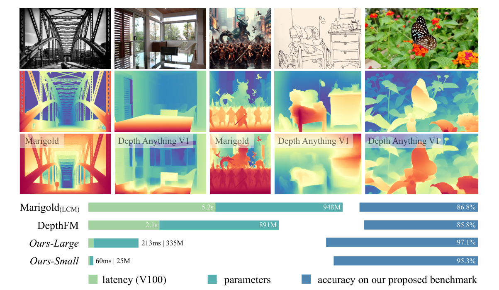

**Original caption:** Figure 1: Depth Anything V2 significantly outperforms V1 [89] in robustness and fine-grained details. Compared with SD-based models [31, 25], it enjoys faster inference speed, fewer parameters, and higher depth accuracy.

**中文图注:** 图 1：Depth Anything V2 在鲁棒性和精细结构预测方面显著优于 V1 [89]。与基于 Stable Diffusion 的模型 [31, 25] 相比，它的推理速度更快、参数更少，深度准确性也更高。

**图内标签:** latency (V100)：V100上的延迟；parameters：参数量；accuracy：准确率；Ours：本文方法。

---

**Source:** p.1 N001

**Original:** Work done during an internship at TikTok.

**中文:** 本研究在 TikTok 实习期间完成。

---

## 1 引言 | 1 Introduction

**Source:** p.2 H0206

---

**Source:** p.2 S002

**Original:** Monocular depth estimation (MDE) is gaining increasing attention, due to its fundamental role in widespread downstream tasks. Precise depth information is not only favorable in classical applications, such as 3D reconstruction [47, 32, 93], navigation [82], and autonomous driving [80], but is also preferable in modern scenarios, e.g., AI-generated content, including images [101], videos [39], and 3D scenes [87, 64, 68]. Therefore, there have been numerous MDE models [56, 7, 6, 95, 26, 38, 31, 89, 88, 25, 20, 52, 28] emerging recently, which are all capable of addressing open-world images.

**中文:** 单目深度估计（monocular depth estimation，MDE）在诸多下游任务中发挥基础作用，因此受到越来越多的关注。精确的深度信息不仅有益于三维重建 [47, 32, 93]、导航 [82] 和自动驾驶 [80] 等经典应用，也有益于现代应用场景，例如包括图像 [101]、视频 [39] 和三维场景 [87, 64, 68] 在内的 AI 生成内容。因此，近期出现了大量 MDE 模型 [56, 7, 6, 95, 26, 38, 31, 89, 88, 25, 20, 52, 28]，它们都能够处理开放世界中的图像。

---

**Source:** p.2 S003

**Original:** From the aspect of model architecture, these works can be divided into two groups. One group [7, 6, 89, 28] is based on discriminative models, e.g., BEiT [4] and DINOv2 [50], while the other [31, 20, 25] is based on generative models, e.g., Stable Diffusion (SD) [59]. In Figure 2, we compare two representative works from the two categories respectively: Depth Anything [89] as a discriminative model and Marigold [31] as a generative model. It can be easily observed that Marigold is superior in modeling the details, while Depth Anything produces more robust predictions for complex scenes. Moreover, as summarized in Table 1, Depth Anything is more efficient and lightweight than Marigold, with different scales to choose from. Meantime, however, Depth Anything is vulnerable to transparent objects and reflections, which are the strengths of Marigold.

**中文:** 从模型架构来看，这些工作可分为两类。一类 [7, 6, 89, 28] 基于判别式模型，例如 BEiT [4] 和 DINOv2 [50]；另一类 [31, 20, 25] 基于生成式模型，例如 Stable Diffusion（SD）[59]。图 2 分别比较了两类中的代表性工作：作为判别式模型的 Depth Anything [89]，以及作为生成式模型的 Marigold [31]。可以明显看出，Marigold 更擅长刻画细节，而 Depth Anything 在复杂场景中给出的预测更加稳健。此外，如表 1 所示，Depth Anything 比 Marigold 更高效、更轻量，并提供不同规模的模型供选择。不过，Depth Anything 容易在透明物体和反射表面上出错，而这些恰好是 Marigold 的优势。

---

### Figure 2 / 图 2

**Source:** p.2 F002

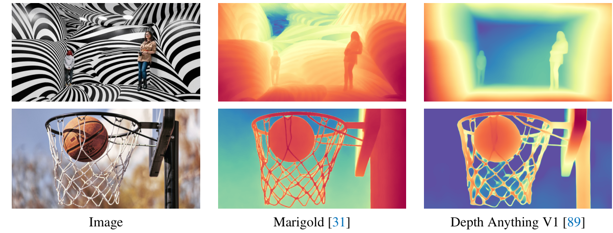

**Original caption:** Figure 2: Robustness (1st row, the misleading room layout) of Depth Anything V1 and Fine-grained detail (2nd row, the thin basketball net) of Marigold.

**中文图注:** 图 2：Depth Anything V1 的鲁棒性（第一行，容易引起误判的房间布局），以及 Marigold 对精细结构的刻画能力（第二行，细密的篮球网）。

---

### Table 1 / 表 1

**Source:** p.2 T001

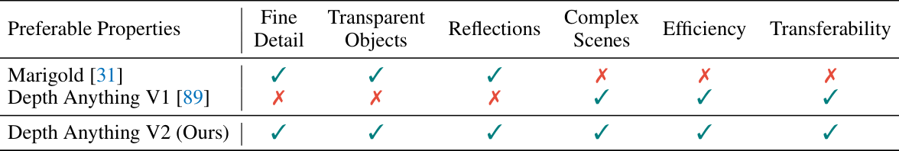

**Original caption:** Table 1: Preferable properties of a powerful monocular depth estimation model.

**中文图注:** 表 1：强大的单目深度估计模型应具备的理想特性。

**图内标签:** Fine detail：精细细节；Transparent objects：透明物体；Reflections：反射；Complex scenes：复杂场景；Efficiency：效率；Transferability：可迁移性。

---

**Source:** p.2 S004

**Original:** In this work, taking all these factors into account, we aim to build a more capable foundation model for monocular depth estimation that can achieve all the strengths listed in Table 1:

**中文:** 综合考虑上述因素，我们希望构建一个能力更强的单目深度估计基础模型，使其具备表 1 中列出的全部优势：

---

**Source:** p.2 S005

**Original:** 

- produce robust predictions for complex scenes, including but not limited to complex layouts, transparent objects (e.g., glass), reflective surfaces (e.g., mirrors, screens) [15], etc.
- contain fine details (comparable to the details of Marigold) in the predicted depth maps, including but not limited to thin objects (e.g., chair legs) [42], small holes, etc.
- provide varied model scales and inference efficiency to support extensive applications [82].
- be generalizable enough to be transferred (i.e., fine-tuned) to downstream tasks, e.g., Depth Anything V1 serves as the pre-trained model for all the leading teams in the 3rd MDEC¹ [72].

**中文:** - 对复杂场景给出稳健的预测，包括但不限于复杂布局、透明物体（例如玻璃）、反射表面（例如镜子、屏幕）[15] 等。
- 在预测深度图中保留精细结构，细节程度可与 Marigold 相当，包括但不限于细小物体（例如椅子腿）[42]、小孔洞等。
- 提供不同的模型规模和推理效率，以支持广泛应用 [82]。
- 具有足够的泛化能力，能够迁移到下游任务，也就是进行微调。例如，第 3 届 MDEC¹ [72] 中各领先团队均使用 Depth Anything V1 作为预训练模型。

---

**Source:** p.2, 3 S006

**Original:** Since the nature of MDE is a discriminative task, we start from Depth Anything V1 [89], aiming to maintain its strengths and rectify its weaknesses. Intriguingly, we will demonstrate that, to achieve such a challenging goal, no fancy or sophisticated techniques need to be developed. The most critical part is still data. It is indeed the same as the data-driven motivation of V1, which harnesses large-scale unlabeled data to speed up data scaling-up and increase the data coverage. In this work, we instead will first revisit its labeled data design, and then highlight the key role of unlabeled data.

**中文:** 由于 MDE 本质上是一项判别式任务，我们从 Depth Anything V1 [89] 出发，希望保留其优势并弥补其不足。有意思的是，我们将证明，要实现这样一个富有挑战性的目标，并不需要开发花哨或复杂的技术；最关键的仍然是数据。这与 V1 的数据驱动动机一致：利用大规模未标注数据加快数据规模扩展，并增加数据覆盖范围。在本文中，我们首先重新审视其带标签数据的设计，然后强调未标注数据的关键作用。

---

**Source:** p.2 N002

**Original:** ¹ https://jspenmar.github.io/MDEC

**中文:** 脚注 1：第 3 届 MDEC 的项目链接为 https://jspenmar.github.io/MDEC 。

---

**Source:** p.3 S007

**Original:** We first present three key findings below. We will clarify them in detail in the following three sections.

**中文:** 下面先给出三个关键发现，并在接下来的三个章节中详细说明。

---

**Source:** p.3 S008

**Original:** Q1 [Section 2]: Whether the coarse depth of MiDaS or Depth Anything come from the discriminative modeling itself? Is it a must to adopt the heavy diffusion-based modeling manner for fine details? A1: No, efficient discriminative models can also produce extremely fine details. The most critical modification is replacing all labeled real images with precise synthetic images.

**中文:** 问题 1［第 2 节］：MiDaS 或 Depth Anything 预测的深度较粗糙，是否源于判别式建模本身？为了得到精细结构，是否必须采用计算开销较大的扩散式建模？

回答 1：不是。高效的判别式模型也能生成极其精细的结构。最关键的改动，是用具有精确标注的合成图像替换全部带标签的真实图像。

---

**Source:** p.3 S009

**Original:** Q2 [Section 3]: Why do most prior works still stick to real images, if as A1 mentioned, synthetic images are already clearly superior to real images? A2: Synthetic images have their drawbacks, which are not trivial to address in previous paradigms.

**中文:** 问题 2［第 3 节］：既然回答 1 表明合成图像已经明显优于真实图像，为什么大多数已有工作仍坚持使用真实图像？

回答 2：合成图像也有缺点，而在以往的范式下，解决这些问题并不容易。

---

**Source:** p.3 S010

**Original:** Q3 [Section 4]: How to avoid the drawbacks of synthetic images and also amplify its advantages? A3: Scale up the teacher model that is solely trained on synthetic images, and then teach (smaller) student models via the bridge of large-scale pseudo-labeled real images.

**中文:** 问题 3［第 4 节］：怎样避免合成图像的缺点，同时发挥其优势？

回答 3：扩大仅用合成图像训练的教师模型，再通过大规模带伪标签的真实图像这一桥梁，训练较小的学生模型。

---

**Source:** p.3 S011

**Original:** After the explorations, we successfully build a more capable MDE foundation model. However, we find current test sets [70] are too noisy to reflect the true strengths of MDE models. Thus, we further construct a versatile evaluation benchmark with precise annotations and diverse scenes (Section 6).

**中文:** 经过这些探索，我们成功构建了一个能力更强的 MDE 基础模型。不过，我们发现现有测试集 [70] 的噪声过大，难以反映 MDE 模型的真实优势。因此，我们进一步构建了一个具有精确标注和多样场景的综合评价基准，详见第 6 节。

---

## 2 重新审视 Depth Anything V1 的带标签数据设计 | 2 Revisiting the Labeled Data Design of Depth Anything V1

**Source:** p.3 H0309

---

**Source:** p.3 S012

**Original:** Building on the pioneering work of MiDaS [56, 7] in zero-shot MDE, recent studies tend to construct larger-scale training datasets in an effort to enhance estimation performance. Notably, Depth Anything V1 [89], Metric3D V1 [95] and V2 [28], as well as ZeroDepth [26], have amassed 1.5M, 8M, 16M, and 15M labeled images from various sources for training, respectively. However, few studies have critically examined this trend: is such a huge amount of labeled images truly advantageous?

**中文:** 在 MiDaS [56, 7] 关于零样本 MDE 的开创性工作基础上，近期研究倾向于构建更大规模的训练集，以提高估计性能。例如，Depth Anything V1 [89]、Metric3D V1 [95] 和 V2 [28]，以及 ZeroDepth [26]，分别从不同来源积累了 1.5M、8M、16M 和 15M 张带标签图像用于训练。然而，鲜有研究认真审视这一趋势：如此大量的带标签图像真的有利吗？

---

**Source:** p.3 S013

**Original:** Before answering it, let us first dig into the potentially overlooked drawbacks of real labeled images.

**中文:** 在回答这个问题之前，我们先深入分析带标签真实图像中可能被忽略的缺点。

---

**Source:** p.3, 4 S014

**Original:** Two disadvantages of real labeled data. 1) Label noise, i.e., inaccurate labels in depth maps. Stemming from the limitations inherent in various collection procedures, real labeled data inevitably contain inaccurate estimations. Such inaccuracies can arise from various factors, such as the inability of depth sensors to accurately capture the depth of transparent objects (Figure 3a), the vulnerability of stereo matching algorithms to textureless or repetitive patterns (Figure 3b), and the susceptible nature of SfM methods in handling dynamic objects or outliers (Figure 3c). 2) Ignored details. These real datasets often overlook certain details in their depth maps. As depicted in Figure 4a, the depth representation of the tree and chair is notably coarse. These datasets struggle to provide detailed supervision at object boundaries or within thin holes, resulting in over-smoothed depth predictions, as seen in the middle of Figure 4c. Hence, these noisy labels are so unreliable that the learned models make similar mistakes (Figure 3d). For example, MiDaS and Depth Anything V1 obtain poor scores of 25.9% and 53.5% respectively in the Transparent Surface Challenge [54] (more details in Table 12: our V2 achieves a competitive score of 83.6% in a zero-shot manner).

**中文:** 带标签真实数据的两个缺点。1）标签噪声，也就是深度图中的标签不准确。受不同采集流程自身局限的影响，真实带标签数据不可避免地包含不准确的估计。这些误差可能来自多种因素，例如深度传感器无法准确测量透明物体的深度（图 3a）、立体匹配算法容易受无纹理或重复纹理区域影响（图 3b），以及 SfM 方法容易受动态物体或离群点干扰（图 3c）。2）被忽略的细节。真实数据集的深度图往往忽略一些细节。如图 4a 所示，树木和椅子的深度表示明显较粗糙。这些数据集难以在物体边界或细小孔洞处提供精细监督，导致深度预测过度平滑，如图 4c 中间一列所示。因此，带噪标签并不可靠，学习它们的模型也会犯类似的错误（图 3d）。例如，在透明表面挑战赛 [54] 中，MiDaS 和 Depth Anything V1 的得分分别只有 25.9% 和 53.5%；更多细节见表 12，我们的 V2 以零样本方式取得了具有竞争力的 83.6%。

---

### Figure 3 / 图 3

**Source:** p.3 F003

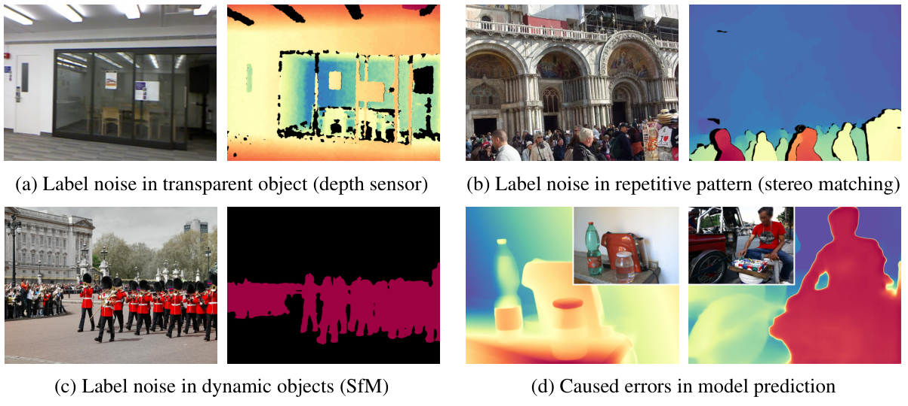

**Original caption:** Figure 3: Various noise in “GT” depth labels (a: NYU-D [70], b: HRWSI [83], c: MegaDepth [37]) and prediction errors in correspondingly trained models (d). Black regions are ignored during training.

**中文图注:** 图 3：“真值”深度标签中的不同噪声来源：a 为 NYU-D [70]，b 为 HRWSI [83]，c 为 MegaDepth [37]；d 为在相应标签上训练的模型所产生的预测错误。黑色区域在训练时被忽略。

**图内标签:** (a)透明物体中的标签噪声（深度传感器）；(b)重复纹理中的标签噪声（立体匹配）；(c)动态物体中的标签噪声（SfM）；(d)相应的模型预测错误。

---

### Figure 4 / 图 4

**Source:** p.4 F004

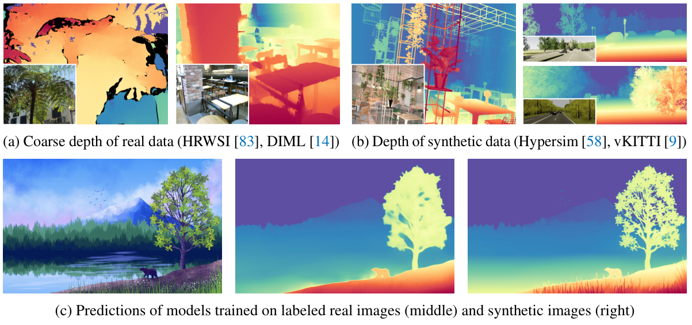

**Original caption:** Figure 4: Depth labels of real images (a) and synthetic images (b), and the corresponding model predictions (c). The labels of synthetic images are highly precise, and so are their trained models.

**中文图注:** 图 4：真实图像的深度标签（a）、合成图像的深度标签（b），以及相应的模型预测（c）。合成图像的标签非常精确，在这些标签上训练的模型也能生成精确预测。

**图内标签:** (a)真实数据的粗糙深度；(b)合成数据的深度；(c)在带标签真实图像（中）和合成图像（右）上训练的模型预测。

---

**Source:** p.4 S015

**Original:** To overcome the above problems, we decide to change our training data and seek images with substantially better annotation. Inspired by several recent SD-based studies [31, 20, 25], that exclusively utilize synthetic images with complete depth information for training, we extensively check the label quality of synthetic images and note their potential to mitigate the drawbacks discussed above.

**中文:** 为克服上述问题，我们决定改变训练数据，寻找标注质量明显更高的图像。受到近期一些基于 SD 的研究 [31, 20, 25] 的启发——这些工作仅用具有完整深度信息的合成图像训练——我们广泛检查了合成图像的标签质量，并发现它们具有缓解上述缺点的潜力。

---

**Source:** p.4 S016

**Original:** Advantages of synthetic images. Their depth labels are highly precise in two folds. 1) All fine details (e.g., boundaries, thin holes, small objects, etc.) are correctly labeled. As demonstrated in Figure 4b, even all thin mesh structures and leaves are annotated with true depth. 2) We can obtain the actual depth of challenging transparent objects and reflective surfaces, e.g., the vase on the table in Figure 4b. In a word, the depth of synthetic images is truly “GT”. In the right side of Figure 4c, we show the fine-grained prediction of a MDE model trained on synthetic images. Moreover, we can quickly enlarge synthetic training images by collecting from graphics engines [58, 63, 53], which would not cause any privacy or ethical concerns, as compared to real images.

**中文:** 合成图像的优势。其深度标签在两个方面非常精确。1）所有精细结构，例如边界、细小孔洞、小物体等，都能得到正确标注。如图 4b 所示，即便细密网状结构和叶片也具有真实深度标注。2）我们能够获得透明物体和反射表面等困难对象的实际深度，例如图 4b 桌上的花瓶。总之，合成图像的深度才是真正的“真值”。图 4c 的右侧展示了用合成图像训练的 MDE 模型所生成的精细预测。此外，我们还可以从图形引擎 [58, 63, 53] 收集图像，迅速扩大合成训练数据；与真实图像相比，这不会带来任何隐私或伦理问题。

---

## 3 使用合成数据面临的挑战 | 3 Challenges in Using Synthetic Data

**Source:** p.4 H0406

---

**Source:** p.4 S017

**Original:** If synthetic data are so advantageous, why are real data still dominating MDE? In this section, we identify two limitations of synthetic images that hinder them from being easily used in reality.

**中文:** 既然合成数据有这么多优势，为什么真实数据仍然主导 MDE？本节指出合成图像的两个局限，它们妨碍合成图像被直接用于现实应用。

---

**Source:** p.4 S018

**Original:** Limitation 1. There exists distribution shift between synthetic and real images. Although current graphics engines strive for photorealistic effects, their style and color distributions still evidently differ from real images. Synthetic images are too “clean” in color and “ordered” in layout, while real images contain more randomness. For instance, when comparing the images in Figure 4a and 4b, we can immediately distinguish the synthetic ones. Such distribution shift makes models struggle to transfer from synthetic to real images, even if the two data sources share similar layouts [57, 9].

**中文:** 局限 1：合成图像与真实图像之间存在分布偏移。尽管当前图形引擎努力追求逼真的效果，合成图像的风格和颜色分布仍然与真实图像存在明显差异。合成图像的颜色过于“干净”，布局过于“规整”，而真实图像含有更多随机性。例如，比较图 4a 和图 4b 中的图像，就能立即分辨出哪些是合成图像。这种分布偏移使模型难以从合成图像迁移到真实图像，即使两种数据来源具有相似的布局也是如此 [57, 9]。

---

**Source:** p.4 S019

**Original:** Limitation 2. Synthetic images have restricted scene coverage. They are iteratively sampled from graphics engines with pre-defined fixed scene types, e.g., “living room” and “street scene”. Consequently, despite the astonishing precision of Hypersim [58] or Virtual KITTI [9] (Figure 4b), we cannot expect models trained on them to generalize well in real-world scenes like “crowded people”. In contrast, some real datasets constructed from web stereo images (e.g., HRWSI [83]) or monocular videos (e.g., MegaDepth [37]), can cover extensive real-world scenes.

**中文:** 局限 2：合成图像的场景覆盖范围有限。它们从图形引擎中预先定义的固定场景类型反复采样，例如“客厅”和“街景”。因此，尽管 Hypersim [58] 或 Virtual KITTI [9] 的标注精度令人惊叹（图 4b），我们也不能指望在这些数据上训练的模型很好地泛化到“人群密集”等真实场景。相比之下，一些利用网络立体图像构建的真实数据集，例如 HRWSI [83]，或利用单目视频构建的数据集，例如 MegaDepth [37]，能够覆盖广泛的真实场景。

---

**Source:** p.5 S020

**Original:** Therefore, synthetic-to-real transfer is non-trivial in MDE. To validate this claim, we conduct a pilot study to learning MDE models solely on synthetic images with four popular pre-trained encoders, including BEiT [4], SAM [33], SynCLR [75], and DINOv2 [50]. As illustrated in Figure 5, only DINOv2-G achieves satisfying results. All other model serials, as well as smaller DINOv2 models, suffer from severe generalization issues. This pilot study seems to give a straightforward solution to employing synthetic data in MDE, i.e., building on the largest DINOv2 encoder, and relying on its inherent generalization ability. However, this naive solution faces two problems. First, DINOv2-G frequently encounters failure cases when the patterns of real test images are rarely presented in synthetic training images. In Figure 6, we can clearly observe incorrect depth predictions for the sky (cloud) and the human head. Such failures can be expected as our synthetic training sets do not include diverse sky patterns or humans. Moreover, most applications cannot accommodate the resource-intensive DINOv2-G model (1.3B) in terms of storage and inference efficiency. Actually, the smallest model in Depth Anything V1 is used most widely due to its real-time speed.

**中文:** 因此，在 MDE 中实现从合成到真实的迁移并不容易。为了验证这一点，我们使用四种流行的预训练编码器开展了探索实验，仅用合成图像训练 MDE 模型；这些编码器包括 BEiT [4]、SAM [33]、SynCLR [75] 和 DINOv2 [50]。如图 5 所示，只有 DINOv2-G 取得了令人满意的结果。其余模型系列以及较小的 DINOv2 模型都存在严重的泛化问题。这个初步实验似乎为在 MDE 中使用合成数据提供了直接方案：采用最大的 DINOv2 编码器，并依赖其固有的泛化能力。然而，这个简单方案仍有两个问题。首先，当真实测试图像中的模式很少出现在合成训练图像中时，DINOv2-G 仍经常失败。图 6 中，天空（云）和人头的深度预测明显不正确。这类失败是可以预期的，因为我们的合成训练集没有包含多样的天空模式或人物。此外，大多数应用无法承受 DINOv2-G（1.3B 参数）在存储和推理效率上的资源开销。事实上，Depth Anything V1 中最小的模型因为具有实时速度而使用最广泛。

---

### Figure 5 / 图 5

**Source:** p.5 F005

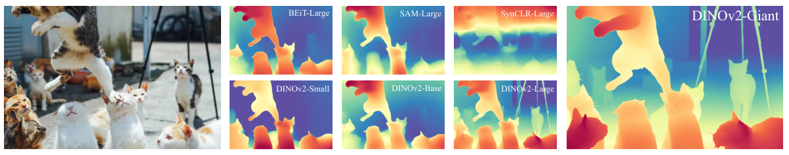

**Original caption:** Figure 5: Qualitative comparison of different vision encoders on synthetic-to-real transfer. Only DINOv2-G produces a satisfying prediction. For quantitative comparisons, please refer to Section B.6.

**中文图注:** 图 5：不同视觉编码器在合成到真实迁移中的定性比较。只有 DINOv2-G 给出了令人满意的预测。定量比较见附录 B.6。

---

### Figure 6 / 图 6

**Source:** p.5 F006

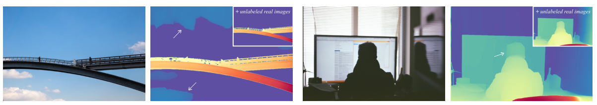

**Original caption:** Figure 6: Failure cases of the most capable DINOv2-G model when purely trained on synthetic images. Left: the sky should be ultra far. Right: the depth of the head is not consistent with the body.

**中文图注:** 图 6：能力最强的 DINOv2-G 模型仅用合成图像训练时的失败案例。左：天空本应非常远。右：头部深度与身体深度不一致。

**图内标签:** + unlabeled real images：加入未标注真实图像后。

---

**Source:** p.5 S021

**Original:** To alleviate the generalization issue, some works [7, 89, 28] use a combined training set of real and synthetic images. Unfortunately, as shown in Section B.9, the coarse depth map of real images is destructive to fine-grained prediction. Another potential solution is to collect more synthetic images, which is unsustainable as creating graphic engines mimicking every real-world scenario is intractable. Therefore, a reliable solution is demanding in building MDE models with synthetic data. In this paper, we will close this gap and present a roadmap that solves the preciseness and robustness dilemma without any trade-offs, and applicable to any model scale.

**中文:** 为了缓解泛化问题，一些工作 [7, 89, 28] 使用真实图像和合成图像混合的训练集。遗憾的是，如附录 B.9 所示，真实图像中的粗糙深度图会破坏精细预测。另一种可能的方案是收集更多合成图像，但这难以持续，因为创建能够模仿所有真实场景的图形引擎并不可行。因此，要利用合成数据构建 MDE 模型，迫切需要一种可靠方案。本文将填补这一缺口，提出一条无需任何取舍即可解决精确性与鲁棒性两难问题、并适用于任意模型规模的路线。

---

## 4 大规模未标注真实图像的关键作用 | 4 Key Role of Large-Scale Unlabeled Real Images

**Source:** p.5 H0508

---

**Source:** p.5 S022

**Original:** Our solution is straightforward: incorporating unlabeled real images. Our most capable MDE model, based on DINOv2-G, is initially trained purely on high-quality synthetic images. Then it assigns pseudo depth labels on unlabeled real images. Lastly, our new models are solely trained with large-scale and precisely pseudo-labeled images. Depth Anything V1 [89] has highlighted the importance of large-scale unlabeled real data. Here, in our special context of synthetic labeled images, we will demonstrate its indispensable role in more details from three perspectives.

**中文:** 我们的方案很直接：引入未标注的真实图像。首先，仅用高质量合成图像训练能力最强的、基于 DINOv2-G 的 MDE 模型；然后，用它为未标注真实图像生成伪深度标签；最后，仅用大规模、具有精确伪标签的图像训练新模型。Depth Anything V1 [89] 已经强调大规模未标注真实数据的重要性。这里，我们将在带标签合成图像这一特定背景下，从三个方面更详细地说明这些真实图像不可替代的作用。

---

**Source:** p.5 S023

**Original:** Bridge the domain gap. As aforementioned, due to the distribution shift, directly transferring from synthetic training images to real test images is challenging. But if we can leverage extra real images as an intermediate learning target, the process will be more reliable. Intuitively, after explicitly training on pseudo-labeled real images, models can be more familiar with real-world data distribution. Compared with manually annotated images, our auto-generated pseudo labels are much more fine-grained and complete, as visualized in Figure 17.

**中文:** 弥合域差异。如前所述，由于存在分布偏移，直接从合成训练图像迁移到真实测试图像很有挑战。如果能利用额外的真实图像作为中间学习目标，这一过程就会更加可靠。直观地说，显式地在带伪标签的真实图像上训练，可以让模型更加熟悉真实世界的数据分布。与人工标注图像相比，我们自动生成的伪标签精细得多、也完整得多，图 17 给出了可视化结果。

---

**Source:** p.6 S024

**Original:** Enhance the scene coverage. The diversity of synthetic images is limited, without including enough real-world scenes. Nevertheless, we can easily cover numerous distinct scenes by incorporating large-scale unlabeled images from public datasets. Moreover, synthetic images are indeed very redundant due to being repetitively sampled from pre-defined videos. In comparison, unlabeled real images are clearly distinguished and very informative. By training on sufficient images and scenes, models not only demonstrate stronger zero-shot MDE capability (as shown in Figure 6 “+ unlabeled real images”), but they can also serve as better pre-trained sources for downstream related tasks [72].

**中文:** 扩大场景覆盖。合成图像多样性有限，不能涵盖足够多的真实场景。但通过引入公开数据集中的大规模未标注图像，我们很容易覆盖大量不同的场景。此外，合成图像往往从预定义视频中反复采样，实际存在较多冗余；相比之下，未标注真实图像之间差异明显，信息也更加丰富。在足够多的图像和场景上训练后，模型不仅展现出更强的零样本 MDE 能力，如图 6 中“+ unlabeled real images”所示，也能成为下游相关任务更好的预训练来源 [72]。

---

**Source:** p.6 S025

**Original:** Transfer knowledge from the most capable model to smaller ones. We have shown in Figure 5, that smaller models cannot directly benefit from synthetic-to-real transfer by themselves. However, armed with large-scale unlabeled real images, they can learn to mimic the high-quality predictions of the most capable model, similar to knowledge distillation [27]. But differently, our distillation is enforced at the label level via extra unlabeled real data, instead of at the feature or logit level with original labeled data. This practice is safer because there is evidence showing feature-level distillation is not always beneficial, especially when the teacher-student scale gap is huge [48]. Finally, as supported in Figure 16, unlabeled images boost the robustness of our smaller models tremendously.

**中文:** 将能力最强模型的知识迁移到较小模型。图 5 已表明，较小模型无法仅凭自身直接受益于合成到真实的迁移。但是，借助大规模未标注真实图像，它们可以学习模仿最强模型的高质量预测，这与知识蒸馏 [27] 类似。区别在于，我们通过额外的未标注真实数据，在标签层面实施蒸馏，而不是在原有带标签数据上进行特征或 logit 层面的蒸馏。这样做更稳妥，因为已有证据表明，特征层面的蒸馏并非总有益，尤其是在教师和学生规模差距很大时 [48]。最后，图 16 也表明，未标注图像极大地提升了较小模型的鲁棒性。

---

## 5 Depth Anything V2 | 5 Depth Anything V2

**Source:** p.6 H0616

---

### 5.1 总体框架 | 5.1 Overall Framework

**Source:** p.6 H0617

---

**Source:** p.6 S026

**Original:** According to all the above analysis, our final pipeline to train Depth Anything V2 is clear (Figure 7). It consists of three steps:

**中文:** 根据上述分析，Depth Anything V2 的最终训练流程已经明确，如图 7 所示。它包括三个步骤：

---

### Figure 7 / 图 7

**Source:** p.6 F007

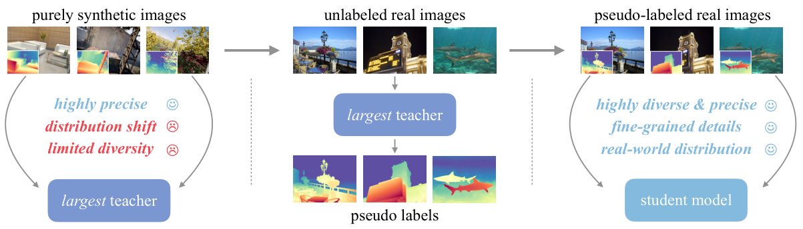

**Original caption:** Figure 7: Depth Anything V2. We first train the most capable teacher on precise synthetic images. Then, to mitigate the distribution shift and limited diversity of synthetic data, we annotate unlabeled real images with the teacher. Finally, we train student models on high-quality pseudo-labeled images.

**中文图注:** 图 7：Depth Anything V2。首先，在具有精确深度标签的合成图像上训练能力最强的教师模型。然后，为缓解合成数据的分布偏移和多样性不足，利用教师为未标注真实图像生成标签。最后，在高质量带伪标签图像上训练学生模型。

**图内标签:** purely synthetic images：纯合成图像；largest teacher：最大教师模型；pseudo labels：伪标签；student model：学生模型；distribution shift：分布偏移；limited diversity：多样性有限。

---

**Source:** p.6 S027

**Original:** 

- train a reliable teacher model based on DINOv2-G purely on high-quality synthetic images.
- produce precise pseudo depth on large-scale unlabeled real images.
- train final student models on pseudo-labeled real images for robust generalization (we will show the synthetic images are not necessary in this step).

**中文:** - 仅使用高质量合成图像，训练基于 DINOv2-G 的可靠教师模型。
- 为大规模未标注真实图像生成精确的伪深度。
- 在带伪标签的真实图像上训练最终学生模型，以获得稳健的泛化能力；我们将证明，这一步不需要使用合成图像。

---

**Source:** p.6 S028

**Original:** We will release four student models, based on DINOv2 small, base, large, and giant, respectively.

**中文:** 我们将发布四种学生模型，分别基于 DINOv2 的 Small、Base、Large 和 Giant。

---

### 5.2 细节 | 5.2 Details

**Source:** p.6 H0621

---

**Source:** p.6 S029

**Original:** As shown in Table 7, we use five precise synthetic datasets (595K images) and eight large-scale pseudo-labeled real datasets (62M images) for training. Same as V1 [89], for each pseudo-labeled sample, we ignore its top-n-largest-loss regions during training, where n is set as 10%. We consider them as potentially noisy pseudo labels. Similarly, our models produce affine-invariant inverse depth². We use two loss terms for optimization on labeled images: a scale- and shift-invariant loss $L_{\mathrm{ssi}}$ and a gradient matching loss $L_{\mathrm{gm}}$. These two objective functions are not new, as they are proposed by MiDaS [56]. But differently, we find $L_{\mathrm{gm}}$ is super beneficial to the depth sharpness when using synthetic images (Section B.7). On pseudo-labeled images, we follow V1 to add an additional feature alignment loss to preserve informative semantics from pre-trained DINOv2 encoders.

**中文:** 如表 7 所示，我们使用五个具有精确标签的合成数据集（595K 张图像）和八个大规模带伪标签的真实数据集（62M 张图像）进行训练。与 V1 [89] 一样，对于每个带伪标签样本，训练时忽略其损失最大的前 n 比例区域，其中 n 设为 10%；我们认为这些区域可能包含有噪声的伪标签。同样，我们的模型输出仿射不变的逆深度²。在带标签图像上，我们使用两项损失进行优化：尺度和平移不变损失 $L_{\mathrm{ssi}}$，以及梯度匹配损失 $L_{\mathrm{gm}}$。这两项目标函数并非新提出，而是来自 MiDaS [56]。不过，与以往不同的是，我们发现使用合成图像时，$L_{\mathrm{gm}}$ 对提高深度边缘的清晰程度尤其有益，详见附录 B.7。对于带伪标签的图像，我们沿用 V1，额外加入特征对齐损失，以保留预训练 DINOv2 编码器中有用的语义信息。

---

**Source:** p.6 N003

**Original:** ² To offer capable metric depth models, we further fine-tune our basic models with metric depth (Section 7.3).

**中文:** 脚注 2：为提供能力较强的米制深度模型，我们进一步使用米制深度对基础模型进行微调，详见第 7.3 节。

---

## 6 新的评价基准：DA-2K | 6 A New Evaluation Benchmark: DA-2K

**Source:** p.7 H0728

---

### 6.1 现有评价基准的局限 | 6.1 Limitations in Existing Benchmarks

**Source:** p.7 H0729

---

**Source:** p.7 S030

**Original:** In Section 2, we demonstrated that commonly used real training sets have noisy depth labels. Here, we further argue that widely adopted test benchmarks are also noisy. Figure 8 illustrates incorrect annotations for mirrors and thin structures on NYU-D [70] despite using specialized depth sensors. Such frequent label noise makes the reported metrics of powerful MDE models not reliable anymore.

**中文:** 第 2 节表明，常用的真实训练集存在带噪声的深度标签。这里，我们进一步指出，广泛使用的测试基准同样存在噪声。图 8 展示了 NYU-D [70] 中镜子和细结构的错误标注，即便该数据集使用了专门的深度传感器也是如此。这类频繁出现的标签噪声，使强大 MDE 模型所报告的评价指标不再可靠。

---

### Figure 8 / 图 8

**Source:** p.7 F008

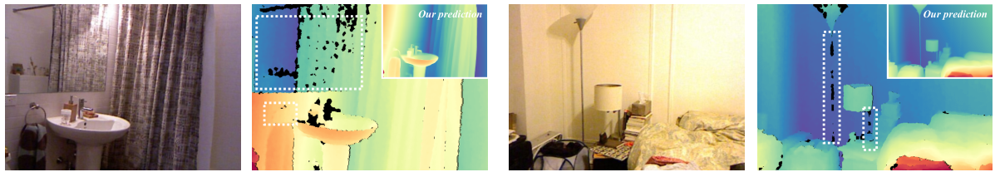

**Original caption:** Figure 8: Visualization of widely adopted but indeed noisy test benchmark [70]. As highlighted, the depth of the mirror and thin structures are incorrect (black pixels are ignored). In comparison, our model predictions are accurate. The noise will cause better models instead achieve lower scores.

**中文图注:** 图 8：一个被广泛使用、但实际存在噪声的测试基准 [70] 的可视化。如标出区域所示，镜子和细结构的深度标注不正确，黑色像素被忽略。相比之下，我们模型的预测是正确的。这样的噪声反而会让更好的模型得到更低分数。

**图内标签:** Our prediction：我们的预测。

---

**Source:** p.7 S031

**Original:** Apart from label noise, another drawback of these benchmarks is limited diversity. Most of them were originally proposed for a single scene. For example, NYU-D [70] focuses on a few indoor rooms, while KITTI [24] only contains several street scenes. Performance on these benchmarks may not reflect real-world reliability. Ideally, we expect MDE models can handle any unseen scenes robustly.

**中文:** 除了标签噪声，这些基准的另一个缺点是多样性有限。它们大多最初只针对单一场景提出。例如，NYU-D [70] 主要是少量室内房间，而 KITTI [24] 只包含若干街景。因此，这些基准上的性能可能无法反映真实世界中的可靠性。理想情况下，我们希望 MDE 模型能够稳健地处理任何未见场景。

---

**Source:** p.7 S032

**Original:** The last problem in these existing benchmarks is low resolution. They mostly provide images with a resolution of around 500×500. But with modern cameras, we usually require precise depth estimation for higher-resolution images, e.g., 1000×2000. It remains unclear whether the conclusions drawn from these low-resolution benchmarks can be safely transferred to high-resolution benchmarks.

**中文:** 这些现有基准的最后一个问题是分辨率较低。它们提供的图像大多只有约 500×500 的分辨率。但现代相机通常要求模型对更高分辨率图像，例如 1000×2000，进行精确深度估计。目前尚不清楚，低分辨率基准上得到的结论能否可靠地迁移到高分辨率基准。

---

### 6.2 DA-2K | 6.2 DA-2K

**Source:** p.7 H0733

---

**Source:** p.7 S033

**Original:** Considering the above three limitations, we aim to construct a versatile evaluation benchmark for relative monocular depth estimation, that can 1) provide precise depth relationship, 2) cover extensive scenes, and 3) contain mostly high-resolution images for modern usage. Indeed, it is impractical for humans to annotate the depth of each pixel, especially for in-the-wild images. Thus, following DIW [11], we annotate sparse depth pairs for each image. Generally, given an image, we can select two pixels on it, and decide their relative depth between them (i.e., which pixel is closer).

**中文:** 针对上述三个局限，我们希望构建一个综合的相对单目深度估计评价基准，使其能够：1）提供精确的深度关系；2）覆盖广泛场景；3）主要由适合现代应用的高分辨率图像组成。事实上，让人工为每个像素标注深度并不可行，尤其是在自然场景图像中。因此，我们沿用 DIW [11] 的思路，为每张图像标注稀疏的深度像素对。一般来说，给定一张图像，可以选出两个像素，并判断二者的相对深度，也就是哪个像素更近。

---

**Source:** p.7 S034

**Original:** Concretely, we employ two distinct pipelines to select pixel pairs. In the first pipeline, as shown in Figure 9a, we use SAM [33] to automatically predict object masks. Instead of using the masks, we leverage key points (pixels) that prompt out them. We randomly sample two key pixels and query four expert models ([89, 31, 20] and ours) to vote on their relative depth. If there is disagreement, the pair will be sent to human annotators to decide the true relative depth. Due to potential ambiguity, annotators can skip any pair. However, there may be cases where all models incorrectly predict challenging pairs, and they are not flagged. To address this, we introduce a second pipeline, where we carefully analyze images and manually identify challenging pairs.

**中文:** 具体而言，我们使用两条不同流程选择像素对。第一条流程如图 9a 所示：先用 SAM [33] 自动预测物体掩码。我们并不直接使用掩码，而是利用那些能够提示生成掩码的关键点，即像素。随机采样两个关键像素，再请四个专家模型——[89, 31, 20] 及我们的方法——对二者的相对深度投票。若模型之间有分歧，就将该像素对交给人工标注者判断真实的相对深度。考虑到可能存在歧义，标注者可以跳过任意像素对。然而，也可能出现所有模型都预测错误的困难像素对，而第一条流程无法将其筛出。为此，我们引入第二条流程：仔细分析图像，人工寻找具有挑战性的像素对。

---

### Figure 9 / 图 9

**Source:** p.7 F009

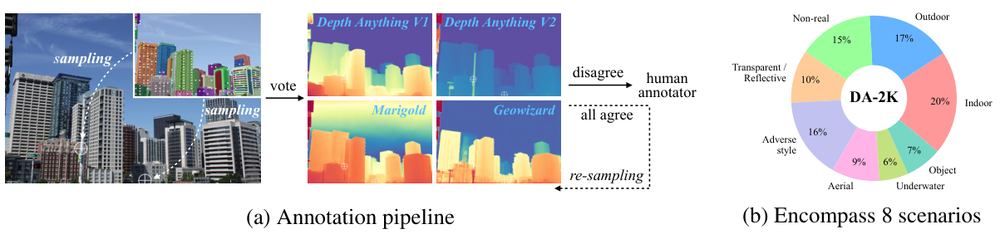

**Original caption:** Figure 9: Our proposed evaluation benchmark DA-2K. (a) The annotation pipeline for relative depth between two points. Points are sampled based on SAM [33] mask predictions. Disagreed pairs among four depth models will be popped out for annotators to label. (b) Detail of our scenario coverage.

**中文图注:** 图 9：我们提出的 DA-2K 评价基准。（a）两点相对深度的标注流程。像素点基于 SAM [33] 的掩码预测采样；四个深度模型出现分歧的像素对会被筛出，交给人工标注。（b）各类场景的覆盖情况。

**图内标签:** sampling：采样；vote：投票；disagree：有分歧；human annotator：人工标注者；all agree：全部一致；re-sampling：重新采样。八类场景为室内、室外、非真实、透明/反射、不利成像风格、物体、航拍、水下。

---

**Source:** p.8 S035

**Original:** To ensure preciseness, all annotations are triple-checked by the other two annotators. To ensure diversity, we first summarize eight important application scenarios of MDE (Figure 9b), and ask GPT-4 to produce diverse keywords related to each scenario. We then use these keywords to download corresponding images from Flickr. Finally, we annotate 1K images with 2K pixel pairs in total. Limited by space, please refer to Section C for details and comparisons with DIW [11].

**中文:** 为确保准确性，所有标注还会由另外两名标注者检查，总共经过三重核查。为确保多样性，我们首先归纳 MDE 的八个重要应用场景（图 9b），并请 GPT-4 为每个场景生成多样的关键词，再利用这些关键词从 Flickr 下载对应图像。最终，我们为 1K 张图像标注了总计 2K 个像素对。受篇幅限制，具体细节及与 DIW [11] 的比较见附录 C。

---

**Source:** p.8 S036

**Original:** Position of DA-2K. Despite the advantages, we do not expect DA-2K to replace current benchmarks. Accurate sparse depth is still far from the precise dense depth required for scene reconstruction. However, DA-2K can be considered a prerequisite for accurate dense depth. As such, we believe DA-2K can serve as a valuable supplement to existing benchmarks due to its extensive scene coverage and precision. It can also serve as a quick prior validation for users selecting community models for specific scenarios covered in DA-2K. Lastly, we believe it is also a potential testbed for the 3D awareness of future multimodal LLMs [41, 21, 3].

**中文:** DA-2K 的定位。尽管 DA-2K 具有上述优势，我们并不希望它替代现有评价基准。准确的稀疏深度，距离场景重建所需的精确稠密深度仍有很大差距。不过，DA-2K 可以被视为实现准确稠密深度的一个前置检验。因此，凭借广泛的场景覆盖和精确标注，我们认为它能成为现有基准的有益补充。它也可作为用户针对 DA-2K 所覆盖的具体场景选择社区模型时，快速进行的初步验证。最后，我们认为它也有潜力成为检验未来多模态大语言模型三维感知能力的测试平台 [41, 21, 3]。

---

## 7 实验 | 7 Experiment

**Source:** p.8 H0814

---

### 7.1 实现细节 | 7.1 Implementation details

**Source:** p.8 H0815

---

**Source:** p.8 S037

**Original:** Follow Depth Anything V1 [89], we use DPT [55] as our depth decoder, built on DINOv2 encoders. All images are trained at the resolution of 518×518 by resizing the shorter size to 518 followed by a random crop. When training the teacher model on synthetic images, we use a batch size of 64 for 160K iterations. In the third stage of training on pseudo-labeled real images, the model is trained with a batch size of 192 for 480K iterations. We use the Adam optimizer and set the learning rate of the encoder and the decoder as 5e-6 and 5e-5, respectively. In both training stages, we do not balance the training datasets, but simply concatenate them. The weight ratio of $L_{\mathrm{ssi}}$ and $L_{\mathrm{gm}}$ is set as 1:2.

**中文:** 沿用 Depth Anything V1 [89]，我们在 DINOv2 编码器的基础上采用 DPT [55] 作为深度解码器。训练时先将图像短边缩放到 518，再随机裁剪，最终使用 518×518 的图像分辨率。教师模型在合成图像上训练时，batch size 为 64，共训练 160K 次迭代；第三阶段在带伪标签的真实图像上训练时，batch size 为 192，共训练 480K 次迭代。我们使用 Adam 优化器，将编码器和解码器的学习率分别设为 5e-6 和 5e-5。两个训练阶段都不对各数据集进行平衡采样，而只是简单地将它们拼接。$L_{\mathrm{ssi}}$ 与 $L_{\mathrm{gm}}$ 的权重比设为 1:2。

---

### 7.2 零样本相对深度估计 | 7.2 Zero-Shot Relative Depth Estimation

**Source:** p.8 H0817

---

**Source:** p.8 S038

**Original:** Performance on conventional benchmarks. Since our model predicts affine-invariant inverse depth, for fairness, we compare with Depth Anything V1 [89] and MiDaS V3.1 [7] on five unseen test datasets. As shown in Table 2, our results are superior to MiDaS and comparable to V1 [89]. We are slightly inferior to V1 in metrics on two of the datasets. However, the plain metrics on these datasets are not the focus of this paper. This version aims to produce fine-grained predictions for thin structures and robust predictions for complex scenes, transparent objects, etc.. Improvement in these dimensions cannot be correctly reflected in current benchmarks.

**中文:** 传统基准上的表现。由于我们的模型预测仿射不变的逆深度，为公平起见，我们在五个未见过的测试数据集上，与 Depth Anything V1 [89] 和 MiDaS V3.1 [7] 进行比较。如表 2 所示，我们的结果优于 MiDaS，与 V1 [89] 相当。在其中两个数据集的指标上，我们略逊于 V1。不过，这些数据集上的常规指标并非本文的重点。这一版本旨在精细预测细结构，并在复杂场景、透明物体等情况下给出稳健预测。现有基准无法准确反映这些方面的改进。

---

### Table 2 / 表 2

**Source:** p.8 T002

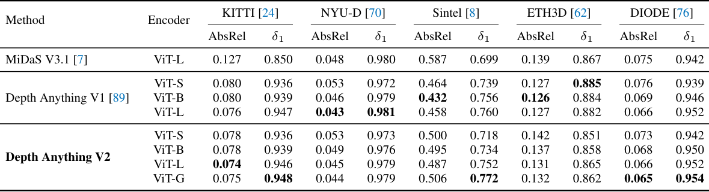

**Original caption:** Table 2: Zero-shot relative depth estimation. Better: AbsRel ↓, δ1 ↑. Solely from the metrics, Depth Anything V2 is better than MiDaS, but merely comparable with V1. But indeed, the focus and strengths of our V2 (e.g., fine-grained details, robust to complex layouts, transparent objects, etc.) cannot be correctly reflected on these benchmarks. Similar results (i.e., better model but worse score) are also observed in [7, 28].

**中文图注:** 表 2：零样本相对深度估计。更好的方向是 AbsRel 降低、δ1 升高。单看这些指标，Depth Anything V2 优于 MiDaS，但仅与 V1 相当。事实上，V2 的关注点和优势，例如精细结构、对复杂布局和透明物体的鲁棒性等，不能由这些基准准确反映。文献 [7, 28] 中也观察到了类似现象，即模型更好，但分数反而更差。

---

**Source:** p.8, 9 S039

**Original:** Performance on our proposed benchmark DA-2K. As shown in Table 3, on our proposed benchmark with diverse scenes, even our smallest model is significantly better than other heavy SD-based models, e.g., Marigold [31] and Geowizard [20]. Our most capable model achieves 10.6% higher accuracy than Margold in terms of relative depth discrimination. Please refer to Table 14 for the comprehensive per-scenario performance of our models.

**中文:** 在我们提出的 DA-2K 基准上的表现。如表 3 所示，在这个具有多样场景的基准上，即便我们最小的模型，也显著优于 Marigold [31]、Geowizard [20] 等其他计算开销较大的 SD 模型。在相对深度判别方面，我们能力最强的模型的准确率比 Marigold 高 10.6%（原文表述）。各模型在不同场景上的完整表现见表 14。

---

### Table 3 / 表 3

**Source:** p.8 T003

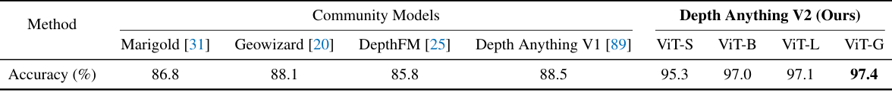

**Original caption:** Table 3: Performance on our proposed DA-2K evaluation benchmark, which encompasses eight representative scenarios. Even our most lightweight model is superior to all other community models.

**中文图注:** 表 3：我们提出的 DA-2K 评价基准上的表现。该基准包含八种具有代表性的场景。即便我们最轻量的模型也优于其他所有社区模型。

**图内标签:** Community Models：社区模型；Ours：本文方法；Accuracy：准确率。

---

### 7.3 微调为米制深度估计模型 | 7.3 Fine-tuned to Metric Depth Estimation

**Source:** p.9 H0922

---

**Source:** p.9 S040

**Original:** To validate the generalization ability of our model, we transfer its encoder to the downstream metric depth estimation task. First, same as V1 [89], we follow the ZoeDepth [6] pipeline, but replace its MiDaS [7] encoder with our pre-trained encoder. As shown in Table 4, we achieve significant improvements over previous methods on both NYU-D and KITTI datasets. Notably, even our most lightweight model which is based on ViT-S, is superior to other models built on ViT-L [6].

**中文:** 为验证模型的泛化能力，我们将其编码器迁移到下游米制深度估计任务。首先，与 V1 [89] 一样，我们沿用 ZoeDepth [6] 的流程，但将其中的 MiDaS [7] 编码器替换为我们的预训练编码器。如表 4 所示，在 NYU-D 和 KITTI 上，我们都相较于以往方法取得了显著改进。值得注意的是，即便基于 ViT-S 的最轻量模型，也优于基于 ViT-L 的其他模型 [6]。

---

### Table 4 / 表 4

**Source:** p.9 T004

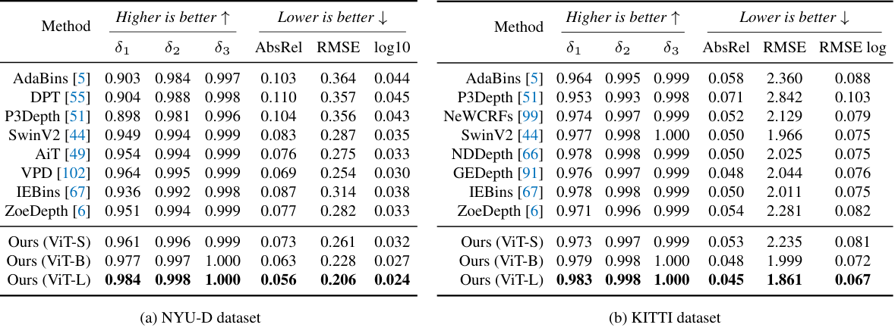

**Original caption:** Table 4: Fine-tuning our Depth Anything V2 pre-trained encoder to in-domain metric depth estimation, i.e., training and test images share the same domain. All compared methods use the encoder size close to ViT-L.

**中文图注:** 表 4：将 Depth Anything V2 的预训练编码器微调到域内米制深度估计任务，即训练图像与测试图像属于同一数据域。所比较方法使用的编码器规模均接近 ViT-L。

**图内标签:** Higher is better：越高越好；Lower is better：越低越好；in-domain：域内。

---

**Source:** p.9 S041

**Original:** Although the reported metrics look impressive, models trained on NYUv2 or KITTI fail to produce fine-grained depth prediction and are not robust to transparent objects, due to the inherent noise in training sets. Therefore, to satisfy real-world applications such as multi-view synthesis, we fine-tune our powerful encoder on Hypersim [58] and Virtual KITTI [9] synthetic datasets, for indoor and outdoor metric depth estimation, respectively. We will release these two metric depth models. Please refer to Figure 15 for qualitative comparisons with the previous ZoeDepth method.

**中文:** 尽管报告的指标看起来很好，由于训练集固有的噪声，在 NYUv2 或 KITTI 上训练的模型仍无法给出精细的深度预测，对透明物体也不够稳健。因此，为满足多视图合成等真实应用，我们分别在 Hypersim [58] 和 Virtual KITTI [9] 合成数据集上微调强大的编码器，用于室内和室外米制深度估计。我们将发布这两个米制深度模型。与以往 ZoeDepth 方法的定性比较见图 15。

---

### 7.4 消融实验 | 7.4 Ablation Study

**Source:** p.9 H0925

---

**Source:** p.9 S042

**Original:** Limited by space, we defer most of our ablations to the appendix except for two on pseudo labels.

**中文:** 受篇幅限制，除了两个关于伪标签的消融实验外，其余大多数消融实验放在附录中。

---

**Source:** p.9 S043

**Original:** Importance of large-scale pseudo-labeled real images. As shown in Table 5, compared with solely trained on synthetic images, our models are greatly enhanced by incorporating pseudo-labeled real images. Different from Depth Anything V1 [89], we further attempt to remove the synthetic images during training student models. We find this can even lead to slightly better results for smaller models (e.g., ViT-S and ViT-B). So we finally choose to train student models purely on pseudo-labeled images. This observation is indeed similar to SAM [33] that only releases its pseudo-labeled masks.

**中文:** 大规模带伪标签真实图像的重要性。如表 5 所示，与仅在合成图像上训练相比，引入带伪标签的真实图像后，模型性能显著增强。与 Depth Anything V1 [89] 不同，我们进一步尝试在学生训练阶段移除合成图像，发现这甚至能让较小模型，例如 ViT-S 和 ViT-B，取得略好的结果。因此，我们最终选择仅用带伪标签的图像训练学生模型。这一观察与 SAM [33] 类似，后者仅发布其伪标注掩码。

---

### Table 5 / 表 5

**Source:** p.9 T005

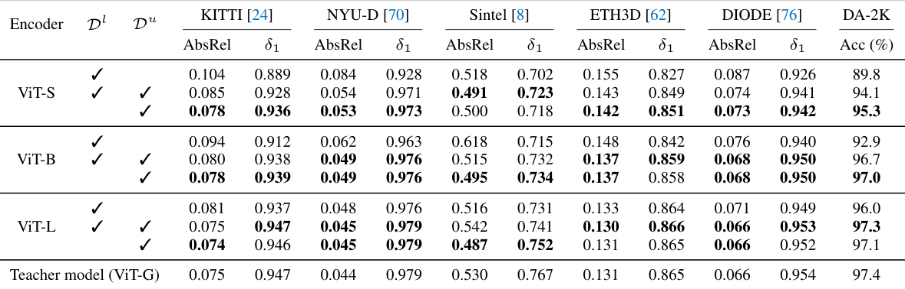

**Original caption:** Table 5: Importance of pseudo-labeled (unlabeled) real images ($D^u$). $D^l$: precisely labeled synthetic images.

**中文图注:** 表 5：带伪标签的（未标注）真实图像 $D^u$ 的重要性。$D^l$ 表示具有精确标签的合成图像。

**图内标签:** Encoder：编码器；Teacher model：教师模型；勾选表示学生训练使用该数据。

---

**Source:** p.10 S044

**Original:** Pseudo label vs. manual label on real labeled images. We have demonstrated before in Figure 4a that existing labeled real datasets are very noisy. Here we conduct a quantitative comparison. We use real images from the DIML [14] dataset, and compare the transferring performance under its original manual label and our produced pseudo label respectively. We can observe in Table 6 that the model trained with pseudo labels is significantly better than the manual-label counterpart. The huge gap indicates the high quality of our pseudo labels and the rich noise in current labeled real datasets.

**中文:** 带标签真实图像上的伪标签与人工标签比较。图 4a 已经表明，现有真实带标签数据集存在较多噪声。这里进行定量比较：使用 DIML [14] 数据集中的真实图像，分别以其原始人工标签和我们生成的伪标签训练，并比较迁移性能。表 6 显示，用伪标签训练的模型明显优于用人工标签训练的模型。这个较大差距表明，我们的伪标签质量较高，而当前带标签真实数据集中存在较多噪声。

---

### Table 6 / 表 6

**Source:** p.10 T006

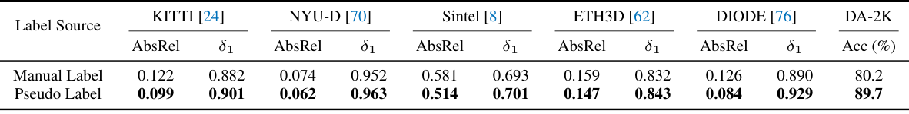

**Original caption:** Table 6: Comparison between originally manual label and our produced pseudo label on the DIML dataset [14]. Our produced pseudo labels are of much higher quality than the manual labels provided by DIML.

**中文图注:** 表 6：在 DIML 数据集 [14] 上，原始人工标签与我们生成的伪标签的比较。我们生成的伪标签质量显著高于 DIML 提供的人工标签。

**图内标签:** Manual Label：人工标签；Pseudo Label：伪标签。

---

## 8 相关工作 | 8 Related Work

**Source:** p.10 H1005

---

**Source:** p.10 S045

**Original:** Monocular depth estimation. Early works [18, 19, 5] focus on the in-domain metric depth estimation, where training and test images must share the same domain [70, 24]. Due to their restricted application scenarios, recently there has been increasing attention on zero-shot relative monocular depth estimation. Among them, some works address this task through better modeling manners, e.g., using Stable Diffusion [59] as a depth denoiser [31, 25, 20]. Other works [94, 96, 89] focus on the data-driven perspective. For example, MiDaS [56, 55, 7] and Metric3D [95] collect 2M and 8M labeled images respectively. Aware of the difficulty of scaling up labeled images, Depth Anything V1 [89] leverages 62M unlabeled images to enhance the model’s robustness. In this work, differently, we point out multiple limitations in widely used labeled real images. We thus especially highlight the necessity of resorting to synthetic images to ensure depth preciseness. Meantime, to tackle the generalization issue caused by synthetic images, we adopt both data-driven (large-scale pseudo-labeled real images) and model-driven (scaling up the teacher model) strategies.

**中文:** 单目深度估计。早期工作 [18, 19, 5] 主要关注域内米制深度估计，其中训练图像与测试图像必须属于同一数据域 [70, 24]。由于应用场景受到限制，近年来零样本相对单目深度估计受到越来越多关注。其中，一些工作通过更好的建模方式解决问题，例如使用 Stable Diffusion [59] 作为深度去噪器 [31, 25, 20]；另一些工作 [94, 96, 89] 则着眼于数据驱动的路线。例如，MiDaS [56, 55, 7] 和 Metric3D [95] 分别收集了 2M 和 8M 张带标签图像。考虑到带标签图像难以扩展，Depth Anything V1 [89] 利用 62M 张未标注图像增强模型鲁棒性。不同于这些工作，本文指出广泛使用的带标签真实图像存在多种局限，因此特别强调利用合成图像保证深度精确性的必要性。同时，为解决合成图像带来的泛化问题，我们同时采用数据驱动策略，即大规模带伪标签真实图像，以及模型驱动策略，即扩大教师模型。

---

**Source:** p.10 S046

**Original:** Learning from unlabeled real images. How to learn informative representations from unlabeled images is widely studied in the field of semi-supervised learning [36, 86, 71, 90]. However, they focus on academic benchmarks [34] which only allow usage of small-scale labeled and unlabeled images. In comparison, we study a real-world application scenario, i.e., how to further boost the baseline of 0.6M labeled images with 62M unlabeled images. Moreover, distinguished from Depth Anything V1 [89], we exhibit the indispensable role of unlabeled real images especially when we replace all labeled real images with synthetic images [22, 23, 61]. We demonstrate “precise synthetic data + pseudo-labeled real data” is a more promising roadmap than labeled real data.

**中文:** 从未标注真实图像中学习。如何从未标注图像中学习有用的表示，在半监督学习领域已得到广泛研究 [36, 86, 71, 90]。不过，这些工作主要关注只允许使用少量带标签和未标注图像的学术基准 [34]。相比之下，我们研究的是真实应用问题：如何利用 62M 张未标注图像，进一步增强由 0.6M 张带标签图像构建的基线。此外，与 Depth Anything V1 [89] 不同，我们揭示了未标注真实图像不可替代的作用，尤其是在将全部带标签真实图像替换为合成图像时 [22, 23, 61]。我们表明，与带标签真实数据相比，“精确合成数据 + 带伪标签真实数据”是一条更有前景的路线。

---

**Source:** p.10 S047

**Original:** Knowledge distillation. We distill transferable knowledge from our most capable teacher model to smaller models. This is similar to the core spirit of knowledge distillation (KD) [27]. But we are also fundamentally different in that we perform distillation at the prediction level through extra unlabeled real images, while KD [2, 73, 100] typically studies better distillation strategies at the feature or logit level through labeled images. We aim to reveal the importance of large-scale unlabeled data and larger teacher model, rather than delicate loss designs [43, 69] or distillation pipelines [10]. Moreover, it is indeed non-trivial and risky to directly distill feature representations between two models with a tremendous scale gap [48]. In comparison, our pseudo-label distillation is easier and safer, even from a model of 1.3B parameters to a model of 25M parameters.

**中文:** 知识蒸馏。我们将能力最强教师模型中的可迁移知识蒸馏到较小模型中，这与知识蒸馏（knowledge distillation，KD）[27] 的核心思想类似。不过，我们也有本质区别：我们通过额外的未标注真实图像，在预测层面进行蒸馏；而 KD [2, 73, 100] 通常研究如何利用带标签图像，在特征或 logit 层面设计更好的蒸馏策略。我们的目标是揭示大规模未标注数据和更大教师模型的重要性，而不是设计精巧的损失 [43, 69] 或蒸馏流程 [10]。此外，直接在规模差距巨大的两个模型之间蒸馏特征表示，确实既不容易也存在风险 [48]。相比之下，我们的伪标签蒸馏更简单、更稳妥，即使从 1.3B 参数的模型蒸馏到 25M 参数的模型也是如此。

---

## 9 结论 | 9 Conclusion

**Source:** p.10 H1009

---

**Source:** p.10 S048

**Original:** In this work, we present Depth Anything V2, a more powerful foundation model for monocular depth estimation. It is capable of 1) providing robust and fine-grained depth prediction, 2) supporting extensive applications with varied model sizes (from 25M to 1.3B parameters), and 3) being easily fine-tuned to downstream tasks as a promising model initialization. We reveal crucial findings to pave the way towards building a strong MDE model. Furthermore, realizing the poor diversity and rich noise in existing test sets, we construct a versatile evaluation benchmark DA-2K, covering diverse high-resolution images with precise and challenging sparse depth labels.

**中文:** 本文提出了 Depth Anything V2，一个能力更强的单目深度估计基础模型。它能够：1）生成稳健且精细的深度预测；2）通过不同模型规模，从 25M 到 1.3B 参数，支持广泛应用；3）作为有潜力的模型初始化，方便地微调到下游任务。我们揭示了若干关键发现，为构建强大的 MDE 模型指明方向。此外，考虑到现有测试集多样性不足、噪声较多，我们构建了一个综合评价基准 DA-2K，覆盖多样的高分辨率图像，并提供精确且有挑战性的稀疏深度标签。

---

## 常用术语与图表标签

| 原文 | 统一中文 |
|---|---|
| monocular depth estimation / MDE | 单目深度估计 |
| relative depth / metric depth | 相对深度 / 米制深度 |
| affine-invariant inverse depth | 仿射不变的逆深度 |
| labeled / unlabeled / pseudo-labeled | 带标签 / 未标注 / 带伪标签 |
| teacher / student | 教师 / 学生 |
| domain gap / distribution shift | 域差异 / 分布偏移 |
| discriminative / generative model | 判别式 / 生成式模型 |
| encoder / decoder | 编码器 / 解码器 |
| knowledge distillation / KD | 知识蒸馏 |
| fine-grained details | 精细结构、精细细节（依语境） |
| zero-shot / in-domain | 零样本迁移 / 域内 |
| ablation study | 消融实验 |
| ground truth / GT | 真值 |
| AbsRel / RMSE | 绝对相对误差 / 均方根误差 |
| latency / parameters / accuracy | 延迟 / 参数量 / 准确率 |

## 整理注记与后续阅读

1. **百分比与百分点：** S039 保留原文“10.6% higher”的表达。表 3 中 97.4% 与 86.8% 相差的是 **10.6 个百分点**，不是相对增长 10.6%。
2. **作者的较强判断：** S016、S021 和部分图注保留作者关于标签、伦理、无取舍等表述；这体现的是原文论述，不是整理者另做实验后确认的普遍结论。表 2 和表 5 仍需逐项阅读。
3. **拼写与排版：** 英文恢复了断行单词、连字、脚注标记及损失下标。S039 中原文将 Marigold 拼成 Margold，英文保留该拼写，中文采用模型正式名称。
4. **米制与相对：** 按 S029、S038、S040—S041 对照不同训练与输出设置；不要将通用相对深度输出直接当作米制距离。
5. **附录：** 原文 p.11—24 包含训练数据、更多消融、DA-2K 和限制；本次未逐段翻译该部分。p.25—30 为参考文献。

辅助理解可阅读 [中文精读指南](paper.md)，详细覆盖和排版记录见 [逐段版整理说明](bilingual_notes.md)。
