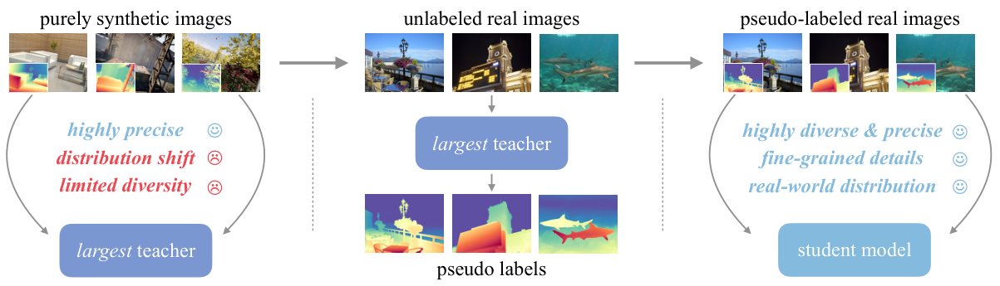
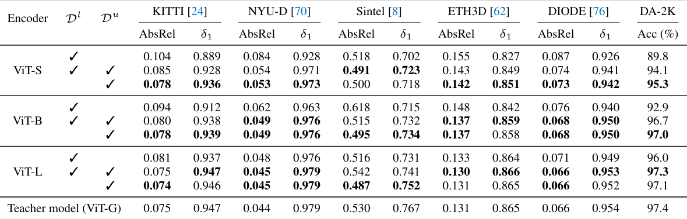

# Depth Anything V2：中文精读指南

按原文逐段阅读请打开 [正文中英逐段对照版](bilingual_main.md)；本文件保留为辅助导读。

**用途：** 帮助第一次阅读者理解正文的论证主线、关键术语与实验。形式为重新组织的中文讲解，阅读时可按页码回到英文原文。

**原论文：** Lihe Yang、Bingyi Kang、Zilong Huang、Zhen Zhao、Xiaogang Xu、Jiashi Feng、Hengshuang Zhao，*Depth Anything V2*，NeurIPS 2024；本地版本为 arXiv `2406.09414v2`，2024-10-20 修订。整理日期：2026-11-08。

**原文入口：** [本地 PDF](../Yang_2024_NeurIPS_Depth_Anything_V2.pdf)、[arXiv 版本记录](https://arxiv.org/abs/2406.09414)、[官方代码](https://github.com/DepthAnything/Depth-Anything-V2)。全文 30 页；本指南梳理正文第 1—10 页，并按需引用附录。下面的“原文 p.”均指 PDF 页码。

## 阅读路线

第一遍读第 1—5 节，建立问题和训练流程；第二遍读第 6—8 节，检查实验到底支持什么；第三遍对照代码和第 9 节的小实验。遇到不认识的词，先查末尾术语表。

| 原文位置 | 本指南对应问题 |
|---|---|
| p.1—3，摘要与引言 | 论文究竟想改善什么？ |
| p.3—5，§2—3 | 为什么标签质量高仍可能泛化不好？ |
| p.5—6，§4—5 | 教师、伪标签和学生怎样连接？ |
| p.7—8，§6 | DA-2K 测什么，不能证明什么？ |
| p.8—10，§7—9 | 哪些对照支撑方法，哪些结论有边界？ |
| p.11—24，附录 | 需要查训练数据、损失影响或失败时再进入 |

## 1. 先认清任务：输入图像，输出什么？

**原文位置：** p.1、p.6 §5.2、p.9 §7.3。

这篇论文研究单目深度估计：输入一张 RGB 图像，预测逐像素的空间远近信息。阅读时先把“深度图看起来合理”与“能准确测量米制距离”分开。普通预训练模型给出的是仿射不变的相对逆深度；论文另外研究了向米制深度微调。

**基础解释：** 对正深度 $z$，逆深度为 $q=1/z$。假设两个点分别在 2 m 和 4 m，它们的逆深度就是 0.5 和 0.25 m$^{-1}$。不过，相对模型的原始数值没有因此自动获得这些单位。将相对输出乘一个任意常数，也不能据此保证恢复真实距离。

“仿射不变”可以先用 $q' = a q + b$ 理解：评价或监督允许消除一定的尺度和平移差异。具体实现还涉及归一化、损失与掩码，需查原方法和代码。这个简式只是解释概念，不能当作论文损失的完整实现。

**读到这里应能回答：** 模型输出的数值是什么含义？自己的应用需要远近排序，还是必须知道几米？这会决定后面怎样选择 checkpoint 和评价协议。

## 2. 为什么从“数据”而不是只从网络结构入手？

**原文位置：** p.2—4，§1—2，图 3—4。

作者关注的是预测细节和复杂场景的可靠性。真实深度标签可能受传感器和生成流程限制：例如透明表面、重复纹理、动态物体及细结构附近，标签可能有误差或缺测。模型学习这些标签时，可能连同错误和过度平滑一起学到。

这里需要建立一个普遍的机器学习判断：训练损失衡量的是模型和“提供的标签”之间的差异，不保证这个标签就是真实物理量。分析深度模型的错误时，应同时看 RGB、有效 GT、预测和标签来源。

论文转向具有精细深度标注的合成数据。学习重点是区分**标签精细程度**与**数据覆盖范围**：前者改善监督质量，后者决定训练是否接触了足够多的场景。两者不能相互替代。

## 3. 为什么有了合成深度，还不能直接解决问题？

**原文位置：** p.4—5，§3，图 5—6。

合成图像与真实图像存在分布差异，合成场景的类型也有限。作者比较了不同预训练视觉编码器，发现强大的 DINOv2-G 教师能较好地承担合成到真实的迁移，但仍有未充分覆盖的真实场景失败，同时计算成本较高。

**基础解释：** 标签质量高，说明“这道训练题的答案可靠”；泛化好，还要求模型能处理测试时的新题。不能从“在合成数据训练得很好”直接推出“在所有真实场景都可靠”。

这也解释了为什么后续不是简单增加更多相同类型的合成图片，而是引入真实图像作为中间环节。

## 4. 核心流程：教师、真实伪标签和学生

**原文位置：** p.5—6，§4、§5.1，图 7。

先把训练链记成三步：

1. 用高质量合成图像及其深度标签训练强教师。
2. 用教师给大量未标注真实图像预测深度，形成伪标签。
3. 用这些真实图像及伪标签训练学生模型。

**图源：** 原文 p.6，图 7；保留原图便于对照。中文读图说明：左侧强调合成监督的优势和局限，中间展示教师生成真实图像的深度标签，右侧用这些样本训练学生。箭头表达训练数据与监督的流向。

**基础解释：** 伪标签是模型预测的监督信号，仍可能有系统误差。它的价值需要通过独立评价与消融证明。“真实图像覆盖更多场景”和“强教师提供监督”是两种作用，阅读时分别追踪证据。

学生训练完成后，普通单图推理不需要每次再调用教师。理解这一点，才能正确分析最终部署模型的开销。

## 5. 网络与训练细节怎样读？

**原文位置：** p.6 §5.2、p.8 §7.1。

先掌握编码器—解码器的数据流：DINOv2 提供图像特征，DPT 将多层特征转换、融合为密集预测。建议沿官方代码的 `infer_image`、`forward` 追踪输入预处理、特征形状、预测与尺寸恢复。

论文使用尺度和平移不变损失 $L_{ssi}$、梯度匹配损失 $L_{gm}$，并在伪标签训练中加入特征对齐。可以分别把它们理解为关注预测形状、空间变化，以及预训练特征的保留。损失名称相似不代表实现可随意替换；阈值、归一化和掩码都会影响实验。

第一轮精读无需立刻复现大规模训练。更有价值的交付是：画出实际推理的数据流，说明每项监督约束什么，以及它不能约束什么。

## 6. DA-2K：判断远近，不等于测量所有距离

**原文位置：** p.7—8，§6、表 3；附录 C 见 p.16—17。

DA-2K 使用稀疏像素对的相对远近关系评价模型，覆盖八类场景；原文规模为 1K 张图像、2K 个像素对。阅读时应关注困难样本怎样被选择、怎样由人工核查，以及选择机制是否会影响覆盖范围。

**基础解释：** 一个模型可能正确判断两个物体谁近谁远，却把二者的绝对距离都预测错。排序评价、稠密深度误差和后续重建误差回答的是不同问题。因此，DA-2K 可以补充深度评价，不能单独替代米制、逐像素或重建任务的测试。

## 7. 重点消融：真实伪标签是否必要？

**原文位置：** p.9，§7.4、表 5。

**表源：** 原文 p.9，表 5。$D^l$ 是有精确标签的合成数据，$D^u$ 是带伪标签的真实数据；勾选表示学生训练使用相应数据来源。阅读时先固定同一编码器，再横向看各评价列，避免将模型规模变化混入数据结论。

例如，ViT-S 在 DA-2K 上仅用合成数据为 **89.8%**，仅用真实伪标签为 **95.3%**，差为 **5.5 个百分点**。但更细的结论要保留条件：ViT-L 的混合数据结果是 **97.3%**，仅用真实伪标签是 **97.1%**。不能把作者最终选择的训练方案概括成“对所有模型、所有指标都最好”。

**阅读训练：** 对每个数字写下四件事：比较对象、唯一变化因素、评价指标、适用的数据与模型范围。看到图像更清晰，也要继续检查量化指标；看到平均指标更高，也要检查失败样本。

## 8. 论文结论的边界

**原文位置：** p.8—10，§7—9；作者限制见附录 p.17 §D。

常规相对深度基准中，V2 并非所有指标都超过 V1；作者强调的改进维度包含细结构和复杂场景。对自己的应用，应保留原有基准，再增加有明确理由的场景分组或指标，而不是只选择有利的结果。

论文还区分域内米制微调与面向应用的合成数据米制微调。不能将一个 checkpoint 的评价结论移到另一个 checkpoint；输出含义、训练数据和评价处理都要重新核对。作者也指出大规模真实图像训练成本，以及合成场景多样性的限制。

**与当前学习目标的连接：** 深度估计为补全、前馈重建或 3DGS 提供了一个可能的模块，但接入后的价值仍需各自实验。单目相对深度尤其需要检查尺度、相机模型与多视图一致性；本文本身不证明它可直接用于你的 ERP 全景或真实端侧系统。

## 9. 读完后做一个小实验

以下是建议，尚未执行。

先选择官方 Small 模型，在固定设备、输入分辨率和预处理下运行一组图片。图片中应包含正常情况，以及细结构、透明/反射、天空或复杂布局等值得观察的例子。保存原图和原始数值输出，记录预热与计时方法；彩图只用于观察，不作为米制精度证据。

如果具有独立深度 GT，再冻结数据划分、有效 mask、crop、深度范围和对齐方式，计算 AbsRel、RMSE、δ1。相对模型的 aligned 结果与米制模型未经 GT 后验对齐的结果分别报告。模型选择或压缩阈值在验证集决定，再做最终测试。

可以复用 [深度练习](../../../03_exercises/05_depth_estimation/README.md) 和 [深度项目入口](../../../04_projects/depth_estimation/README.md)。第一轮的目标是解释输入输出、流程和失败，不以重做论文规模的训练作为前置。

## 术语表

| 英文 | 本指南用语 | 阅读时的判断点 |
|---|---|---|
| monocular depth estimation, MDE | 单目深度估计 | 单图输入能提供什么约束 |
| relative / metric depth | 相对 / 米制深度 | 是否有可解释的绝对单位 |
| inverse depth | 逆深度 | 与深度取倒数，先核对输出定义 |
| affine-invariant | 仿射不变 | 尺度和平移如何被处理 |
| synthetic data | 合成数据 | 标签质量和分布覆盖分别检查 |
| domain gap | 域差异 | 训练与应用输入分布是否一致 |
| pseudo label | 伪标签 | 模型生成，仍有误差 |
| teacher / student | 教师 / 学生 | 训练关系与最终推理关系 |
| knowledge distillation | 知识蒸馏 | 转移的是什么监督或表示 |
| encoder / decoder | 编码器 / 解码器 | 特征如何变成逐像素输出 |
| zero-shot | 零样本迁移 | 需核对论文具体训练/测试划分 |
| ablation study | 消融实验 | 变化因素和共同条件是否明确 |

## 阅读自测

1. 这篇论文主要改变了训练数据、教师能力，还是发明了全新的深度几何模型？请指出证据。
2. 教师能预测真实图像，为什么还需要训练学生？
3. 相对逆深度图需要怎样的额外条件才能服务米制重建？
4. 表 5 支持哪些判断，又有哪些“所有情况都更好”的说法站不住？
5. 用同一张漂亮的深度彩图，可以证明哪些事情，不能证明哪些事情？

图表裁剪、范围与核验说明见 [整理说明](translation_notes.md)，来源索引见 `source_map.json`。插件使用入口见 [翻译工具](translation_tools.md)。
